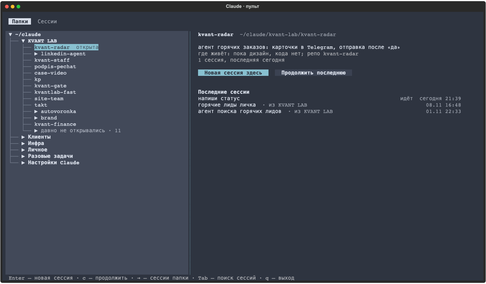

# Панель управления папками Claude

Окно в терминале, из которого Claude Code запускается сразу в нужной папке проекта.
Решает одну задачу: сессия должна рождаться у проекта, а не в домашней папке,
и для этого не нужно помнить пути.



## Что умеет

Два режима, Tab переключает. Без эмодзи; тема `nord`, другую можно задать `C_THEME=catppuccin-mocha c`.
Цветом выделено только то, что ждёт вашего ответа; остальное — обычный и тусклый текст.

**Папки** — с него окно открывается: увидеть все проекты и начать или продолжить сессию.

- Дерево `~/claude`, в строках только имена: разделы → проекты → части (рабочие копии
  `.claude/worktrees/*`, подпапки со своим `CLAUDE.md`). Раскрыт KVANT LAB, остальные разделы
  свёрнуты. В разделе сверху проекты, где работа шла за последние две недели, самые свежие выше;
  остальные свёрнуты в «давно не открывались · N». Работой считаются сессии самой папки и её частей,
  живая сессия и сессии из корня или раздела, которые уходили в эту папку (по `cwd`); прогоны
  без человека в чужие папки не засчитываются. Рядом с именем — «идёт» или «ждёт ответа», если там
  сейчас сессия.
- Справа описание и где живёт (таблицы `CLAUDE.md`), сколько сессий и когда последняя, кнопки
  «Новая сессия здесь» и «Продолжить последнюю», ниже восемь последних сессий: её собственные
  и сессии из раздела выше, которые в ней работали (подписаны «из KVANT LAB»).
- Enter — новая сессия: спросит, о чём (имя «проект · о чём», можно пусто); на разделе Enter
  раскрывает. `c` — продолжить последнюю, → — к сессиям папки (Enter открывает), `q` — выход.

**Сессии** — найти сессию по памяти и вернуться в неё.

- Курсор сразу в строке поиска. Под ней все ваши сессии из всех папок `~/claude`:
  ждущие ответа первыми, дальше свежие выше. Прогоны без человека (`claude -p`: ежедневная
  проверка, задачи пульта) скрыты; «ждёт ответа» панель видит только у фоновых сессий Claude Code
  (`claude agents`, `~/.claude/jobs`), вопрос задачи пульта остаётся в пульте.
- Подпись — название сессии без приписки «проект · »; если названия нет или оно повторяет
  имя папки (`kp`, `nicky (2)`) — первая строка первого запроса.
- Печатайте слова: остаются сессии, где все слова есть в названии, первом или последнем запросе,
  имени папки запуска или описании проекта (описание раздела не в счёт — оно перечисляет все
  проекты). Регистр и ё/е не важны. Ниже — «Новая сессия в папке» с подходящими папками.
- Справа — что внутри выбранной: где запущена и где работала (доли по `cwd`), когда, первый
  и последний запрос, последний ответ, чем кончилась или что с ней сейчас.
- ↑↓ выбрать, Enter открыть (живую фоновую — `claude attach`; открытую в другом терминале
  второй раз не запускает и подсказывает переключиться), Esc очистить поиск, ещё раз — выход.

Список строится из дерева папок без отдельного конфига. Новый проект появляется сам.

## Установка

```sh
git clone git@github.com:Just-trying-to-make-something-cool/claude-panel.git ~/claude/claude-settings/claude-panel
~/claude/claude-settings/claude-panel/install.sh
```

Установщик создаёт `.venv` с Textual, ставит fzf через Homebrew для запасного режима
и кладёт команду `c` (и русскую `с`, чтобы раскладка не мешала) в `~/.local/bin`.
Нужны macOS, Python 3.12+, Claude Code 2.1.2xx+.

## Использование

```
c              открыть панель
c --list       таблица мест запуска текстом
c --fzf        запасной двухшаговый режим на fzf
c --dry ПАПКА [continue|new|resume] [имя]   показать команду запуска, не запуская
C_PLAIN=1 c    запуск без zellij
C_PAIR=1 c     запуск в паре с Codex-ревьюером (по умолчанию — если есть ~/.claude/pair-codex)
```

«Продолжить» открывает последнюю сессию папки, начатую человеком, по её id (`claude -r ID`;
живую фоновую — `claude attach`). `claude -c` не годится: он сразу выходит, когда последняя
сессия идёт в фоне, и берёт самую свежую стенограмму, а это бывает прогон робота.

Пара с Codex: если есть файл `~/.claude/pair-codex` (или `C_PAIR=1`) и команда `rev` из
claude-setup, сессия запускается через `rev --here`: окно делится, слева Claude, справа
Codex-ревьюер. `C_PAIR=0 c` — без пары; с `C_PLAIN=1` и внутри zellij пара не включается.

Если установлен `~/.local/bin/zellij`, Claude запускается внутри его окна: тогда в окно может
печатать пульт агентов с телефона. Снаружи всё как раньше: `/exit` закрывает окно.

Внутри уже открытой сессии Claude тот же переезд в другую папку делает `/cd <путь>`.

## Откуда данные

| что | откуда |
|---|---|
| описание, где живёт | таблицы `\| папка \| что \| где \|` в `CLAUDE.md` родительской папки |
| сессий, последняя | `~/.claude/projects/<путь, где всё кроме букв и цифр заменено на ->/*.jsonl` |
| что внутри сессии | те же `*.jsonl`: `customTitle`, реплики `type: user/assistant`, `cwd`, `gitBranch` |
| где недавно работали | `cwd` в сессиях корня и сегментов за 14 дней; счётчики в `~/.cache/claude-panel/places.json`, при запуске дочитывается только новый хвост стенограммы |
| живые сессии | `claude agents --json` |
| «ждёт ответа» | `~/.claude/jobs/*/state.json` со `state: blocked` |

Формат этих файлов внутренний для Claude Code и может меняться; панель только читает.

## Устройство

```
panel/core.py   обход дерева, разбор таблиц, статистика, общий список сессий и поиск, запуск (claude -r ID / -n / attach, с парой — rev --here)
panel/tui.py    окно на Textual
bin/c           обёртка: окно из .venv, служебные флаги через core.py
tests/          unittest; окно тестируется безголово через Textual Pilot
```

Стенограммы бывают по 90 МБ, поэтому название и первый запрос читаются из начала и хвоста
файла, последний обмен — из хвоста, «где работала» — одним проходом по сырым байтам в фоне.
Результаты кэшируются по времени изменения файла.

Тесты: `.venv/bin/python -m unittest discover -s tests`.
Снимок окна: `app.save_screenshot('x.svg')` в тесте, затем `qlmanage -t -s 1600 -o . x.svg`.
